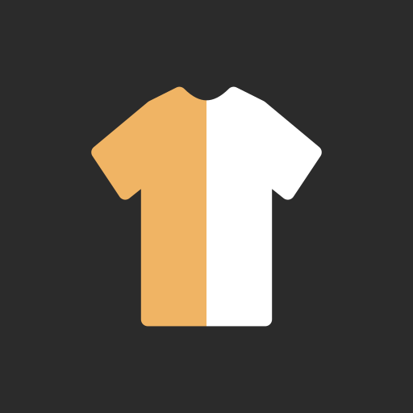

# Garment Colour

Point an Android phone at an outfit and get the same photo back with the garments' **true
colours**: the colour cast of the light removed, folds, shadows and weave kept. Each garment
is found and reported with its measured colour — Lab, XYZ, hex. Everything runs on the phone,
from one photo, with no reference card.

Android 16+ · Kotlin · Jetpack Compose · CameraX · MediaPipe + ONNX Runtime · no internet
permission.

## How it works

1. **Find the garments.** MediaPipe's selfie model separates scene, skin, hair and clothes;
   SegFormer B2 names each garment.
2. **Read the light from everything that is *not* a garment.** A red dress filling half the
   frame would otherwise convince any gray-world method that the light is red.
   Shades-of-gray, gray-edge and a skin anchor each estimate it; their disagreement is the
   confidence.
3. **Correct.** One Bradford adaptation to daylight, as a single 3 × 3 matrix in linear light,
   applied to every pixel — so texture survives.
4. **Say when unsure.** A low-confidence result says why and offers a way out: tap something
   white or grey in the photo.

**RAW**, on phones whose camera offers it: a switch on the capture screen takes a DNG instead
of a JPEG, and the correction works from the sensor data with the camera's own colour
matrices — no phone white balance, no tone curve to undo. **Drag a box** around a garment
the models missed and GrabCut cuts it out.

The colour maths is a pure-Kotlin module checked line for line against a Python reference.

## Status

Built and checked on the JVM; **never yet run on a phone**. The accuracy so far is measured
on synthetic scenes only. See [`docs/README.md`](docs/README.md) for exactly what has and has
not been checked, and [`docs/04-accuracy/hld.md`](docs/04-accuracy/hld.md) for the numbers.

## Building (Windows or anything with Docker)

Nothing but Docker is needed on the host; every script is time-limited.

```bash
tool/models_in_docker.sh      # download, verify and quantise the two models (once)
tool/build_in_docker.sh       # every unit test, then build/docker/garment-colour-debug-*.apk
tool/test_in_docker.sh        # unit tests only
tool/test_in_docker.sh dng    # real DNGs in build/check/dng/ through the RAW path
tool/spike_in_docker.sh test  # the Python reference
tool/spike_in_docker.sh bench # the synthetic benchmark
```

Install `build/docker/garment-colour-debug-arm64-v8a.apk` on the phone with `adb install -r`.

## Documents

[`docs/PRD.md`](docs/PRD.md) is the product; [`docs/00-overview/decisions.md`](docs/00-overview/decisions.md)
holds the why behind every choice; [`AGENTS.md`](AGENTS.md) is how work is done here.

## Licences

The code and documents are MIT — see [`LICENSE`](LICENSE). The models are not in this
repository; `tool/models_in_docker.sh` downloads them, and each keeps its own terms:

- MediaPipe Selfie Multiclass — Google, Apache 2.0.
- SegFormer B2 clothes — `mattmdjaga/segformer_b2_clothes`. Training code MIT; the weights'
  model card says `license: other` and states no terms; trained on ATR, which has research
  terms. Fine for a personal side-loaded build; read the terms before any public listing.
